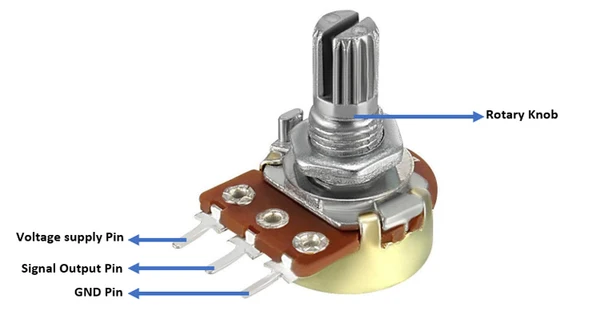
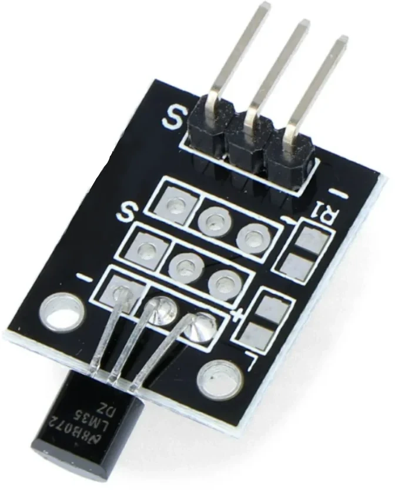
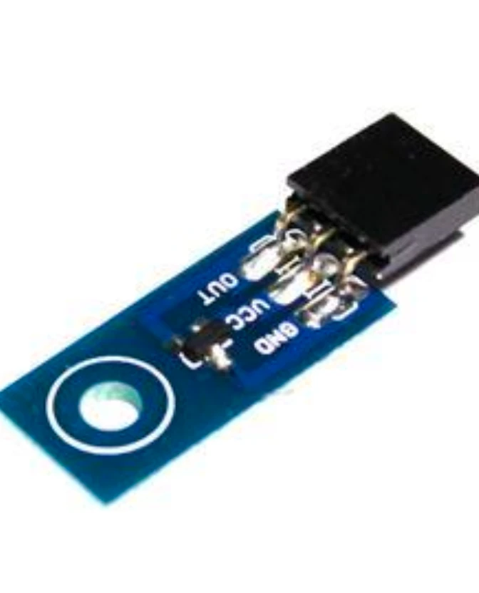
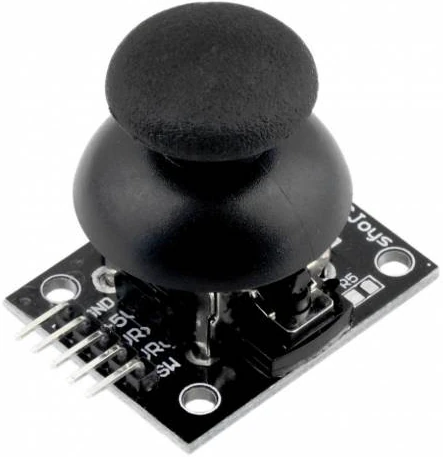

# LAB 6

**ANALOG SIGNALS**

<details>

<summary>Ex 1 - Potentiometer</summary>

## Ex 1 - Potentiometer


WH148 Single Potentiometer B10K 3pin 15mm

```cpp
#include <LiquidCrystal.h>

// LCD WITH BUTTONS
// LiquidCrystal lcd(8, 9, 4, 5, 6, 7);

// LCD WITHOUT BUTTONS
LiquidCrystal lcd(7, 6, 5, 4, 3, 2);

const int ANALOG_PIN = A8;

void setup() {
  analogReference(DEFAULT);  // set the reference voltage to the
                             // default value (optional)
  lcd.begin(16, 2);          // init LCD
  lcd.setCursor(0, 0);
  lcd.print("Read sensor");
  pinMode(ANALOG_PIN, INPUT);  // Set the pin as the input (make sure that it was not set as output)
}

void loop() {
  int val = analogRead(ANALOG_PIN);  //reading the analog value
  lcd.setCursor(0, 1);
  lcd.print(val);
}
```

</details>

<details>

<summary>Ex 2 - Analog Temp</summary>

## Ex 2 - Analog temperature sensor

|||
|:-:|:-:|
|||
|**LM35**|**LM50**|

For the **LM35**:
- `R1 -   --> GND`
- `Middle --> 5V`
- `S      --> Analog pin`

```cpp
float resolutionADC = .0049;   // default ADC resolution for the 5V
                               // reference = 0.049 [V] / unit
float resolutionSensor = .01;  // sensor resolution = 0.01V / °C

// float offsetSensor = 0.0; // LM35
float offsetSensor = 0.5;    // LM50

const int ANALOG_PIN = A8;

void setup() {
  Serial.begin(9600);
}

void loop() {
  Serial.print("Temp [C]: ");
  float temp = readTempInCelsius(10, ANALOG_PIN); // read temp. 10 times and return the average
  Serial.println(temp);                           // display the result
  delay(200);
}

float readTempInCelsius(int count, int pin) {
  // read temp. count times from the analog pin
  float sumTemp = 0;
  for (int i = 0; i < count; i++) {
    int reading = analogRead(pin);
    float voltage = reading * resolutionADC;

    // subtract the DC offset and converts the value in degrees (C)
    float tempCelsius = (voltage - offsetSensor) / resolutionSensor;
    sumTemp = sumTemp + tempCelsius;  // accumulates the readings
  }
  return sumTemp / (float)count;  // return the average value
}
```

</details>

<details>

<summary>Ex 3 - Joystick</summary>



## Ex 3 - Joystick

```cpp
#include <LiquidCrystal.h>

// LCD WITH BUTTONS
// LiquidCrystal lcd(8, 9, 4, 5, 6, 7);

// LCD WITHOUT BUTTONS
LiquidCrystal lcd(7, 6, 5, 4, 3, 2);

const int X_AXIS_PIN  = A0;
const int Y_AXIS_PIN  = A1;
const int JOY_BTN_PIN = 21;   // needs the internal pull-up

void setup() {
  pinMode(JOY_BTN_PIN, INPUT_PULLUP);
  lcd.begin(16, 2);
}

void loop() {
  int x = analogRead(X_AXIS_PIN);
  int y = analogRead(Y_AXIS_PIN);
  bool pressed = (digitalRead(JOY_BTN_PIN) == LOW);  // pull-up: LOW = pressed

  lcd.setCursor(0, 0);
  lcd.print("X:"); lcd.print(x); lcd.print("   ");   // spaces erase old digits
  lcd.setCursor(8, 0);
  lcd.print("Y:"); lcd.print(y); lcd.print("   ");

  lcd.setCursor(0, 1);
  lcd.print(pressed ? "PRESSED " : "        ");

  delay(100);                               // ~10 updates per second
}
```

</details>

<details>

<summary>Ex 4 - ADC</summary>

## Ex 4 - ADC General

For the **LM35**:
- `-      --> 5V!!!!`
- `Middle --> GND!!!`
- `S      --> Analog pin`

```cpp
#include <LiquidCrystal.h>

// LCD WITH BUTTONS
// LiquidCrystal lcd(8, 9, 4, 5, 6, 7);

// LCD WITHOUT BUTTONS
LiquidCrystal lcd(7, 6, 5, 4, 3, 2);

void setup() {
  ADCSRA |= ((1 << ADPS2) | (1 << ADPS1) | (1 << ADPS0));  // set the ADC clock to 16MHz/128 = 125kHz
  ADMUX  |= (1 << REFS0);                                  // Set the ref. voltage to Vcc (5V)
  ADCSRA |= (1 << ADEN);                                   // Activate the ADC
  ADCSRA |= (1 << ADSC);
}


void loop() {
  int val = read_adc(1);  // MUX index, don't use A0, A1, etc here, use 0 1 ... for the parameter
  lcd.setCursor(0, 1);
  lcd.print("    ");
  lcd.setCursor(0, 1);
  lcd.print(val);
  delay(100);
}

uint16_t read_adc(uint8_t channel) {
  ADMUX &= 0xE0;                // delete MUX0-4 bits
  ADMUX |= channel & 0x07;      // Sets in MUX0-2 the value of the
                                // new channel to be read
  ADCSRB = channel & (1 << 3);  // Set MUX5 value
  ADCSRA |= (1 << ADSC);        // start conversion
  while (ADCSRA & (1 << ADSC))
    ;  // Wait for the conversion to finish
  return ADCW;
}
```

</details>
